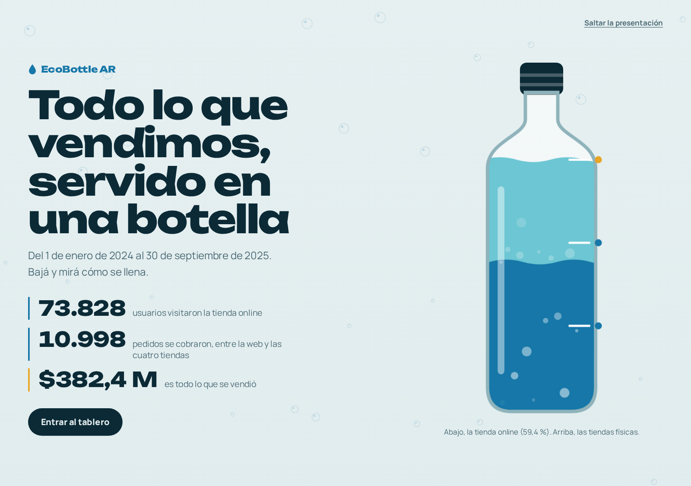
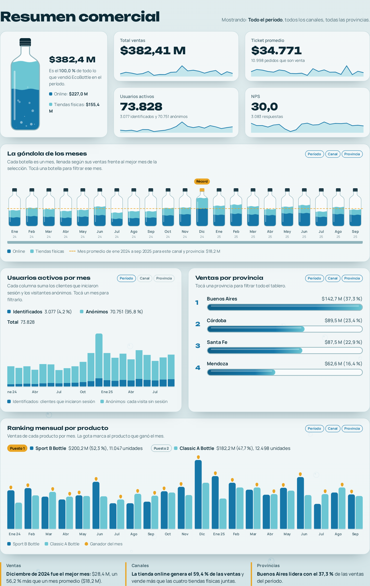
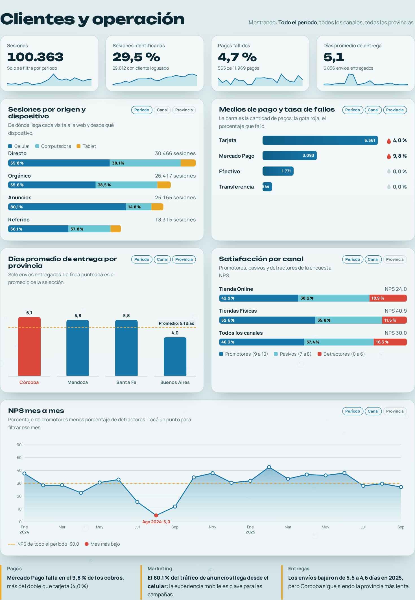
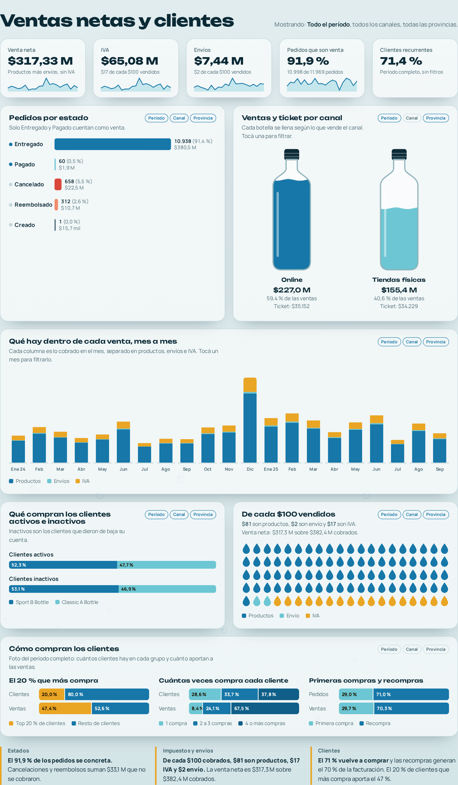
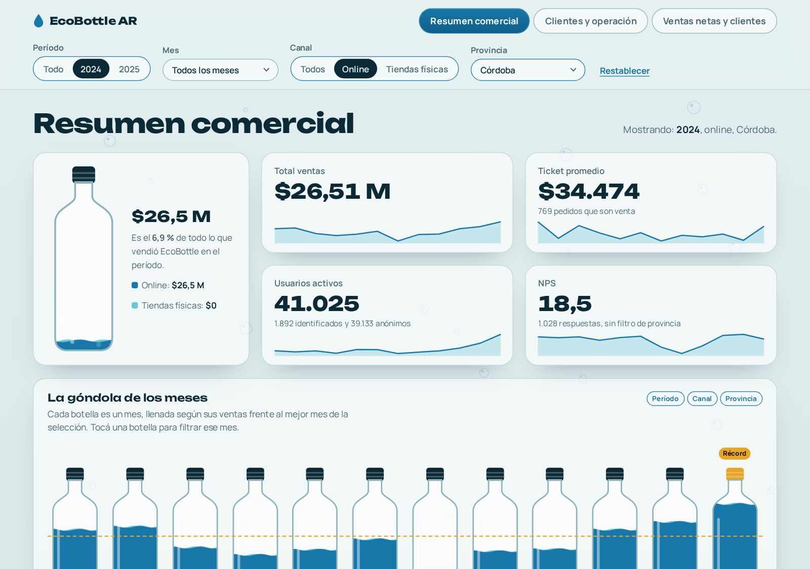

# EcoBottle AR: data warehouse y visualización comercial

Trabajo final de **Introducción al Marketing Online y los Negocios Digitales**. Con los datos de EcoBottle AR (botellas reutilizables, tienda online y 4 tiendas físicas) se armó un data warehouse con modelo estrella en DuckDB y una visualización web hecha con IA en HTML, CSS y JavaScript, publicada con GitHub Pages.

**Visualización web (HTML, CSS y JS):** [kiaramanacasa.github.io/practica-imond](https://kiaramanacasa.github.io/practica-imond/)

## Arquitectura

```
raw/  →  sql/ (ELT en DuckDB)  →  dw/modelo_estrella/  →  dw/mart/  →  web/  →  GitHub Pages
```

Los datos de origen (`raw/`) se cargan en DuckDB y se transforman con SQL. El resultado se guarda en `dw/`, que separa el **modelo estrella** (dimensiones y hechos) de los **data marts**, que se leen del modelo estrella. La visualización web lee solo los marts y no calcula ninguna medida: todas vienen calculadas desde SQL.

## Visualización web

Arranca con una **carátula**: una botella de medir que se llena a medida que se baja, y en cada raya aparece un dato del período (usuarios, pedidos cobrados y ventas). Al llenarse, un botón lleva al tablero.



Después viene un tablero interactivo en tres pestañas, con el mismo recorrido que un tablero de BI, pero hecho en HTML, CSS y JavaScript. Todo se muestra como agua, porque EcoBottle vende botellas: cada botella se llena según un nivel (de 0 a 1) que ya viene calculado en el mart.

**Filtros:** período (todo, 2024 o 2025), mes, canal y provincia. También se filtra tocando los gráficos: una botella de la góndola o un punto del NPS filtra ese mes, una provincia filtra esa provincia y una botella de canal filtra ese canal. Cada gráfico indica a qué filtros responde.

**Pestaña 1, Resumen comercial:** botella con las ventas de la selección y su peso sobre el total, KPIs con su evolución mensual, la góndola de los meses, usuarios activos separados en identificados y anónimos, ventas por provincia y ranking mensual por producto.



**Pestaña 2, Clientes y operación:** sesiones, pagos fallidos y días de entrega; tráfico por origen y dispositivo, medios de pago, entregas por provincia, satisfacción por canal y NPS mes a mes.



**Pestaña 3, Ventas netas y clientes:** venta neta, IVA, envíos, pedidos que son venta y clientes recurrentes; pedidos por estado, ventas y ticket por canal, qué hay dentro de cada venta (productos, envíos e IVA) mes a mes y de cada $100, compras de clientes activos e inactivos, y cómo compran los clientes.



**Ejemplo con filtros:** 2024, canal online y Córdoba.



## Estructura del repositorio

```
raw/               datos de origen: un CSV por tabla (no se modifican)
sql/               transformaciones en SQL, en orden de ejecución:
  01_dimensiones.sql   crea las 9 dimensiones
  02_hechos.sql        crea las 6 tablas de hechos
  03_consultas.sql     consultas clave de análisis
  04_marts.sql         genera los 11 data marts que lee la web (con GROUPING SETS)
run_sql.py         ejecuta los archivos de sql/ y arma el data warehouse
requirements.txt   dependencias de Python (DuckDB)
dw/                salida del data warehouse (CSV):
  modelo_estrella/     dimensiones (dim_), hechos (fact_) y modelo_estrella.md
  mart/                data marts (mart_*), con las medidas ya calculadas
web/               visualización: index.html, styles.css y app.js
index.html         redirige a web/ (portada de GitHub Pages)
assets/            capturas de la web, modelo estrella y DER de origen
generator/         programa que creó los datos de raw/ (no hace falta usarlo)
```

## Cómo reproducirlo

Requiere Python 3 y Git. Desde la Terminal:

```
git clone https://github.com/Kiaramanacasa/practica-imond.git
cd practica-imond
python3 -m venv venv
source venv/bin/activate
pip install -r requirements.txt
python3 run_sql.py
```

Esto crea `warehouse.duckdb` desde cero (no se sube a GitHub), regenera los CSV de `dw/modelo_estrella/` y `dw/mart/` y redibuja `dw/modelo_estrella/modelo_estrella.md`. Las tablas `dw/mart/mart_*.csv` alimentan la visualización web.

Para ver la visualización web en la computadora (el navegador no deja leer los CSV si se abre el archivo con doble clic):

```
python3 -m http.server
```

y entrar a `http://localhost:8000/web/`.

## Modelo estrella


*La imagen es ancha: hacé clic para verla en tamaño completo. El diagrama editable está en [`dw/modelo_estrella/modelo_estrella.md`](dw/modelo_estrella/modelo_estrella.md).*

El data warehouse sigue el modelo dimensional de Kimball: **6 tablas de hechos** (pedidos, ítems de pedido, sesiones web, NPS, pagos y envíos) rodeadas por **9 dimensiones** (producto, fecha, canal, provincia, cliente, tienda, origen de tráfico, dispositivo y medio de pago). Se validó que cada hecho tiene las mismas filas que su tabla de origen, que las ventas por provincia suman el total y que los pagos están conciliados con las ventas.

## Supuestos

- **Todas las medidas se calculan en SQL, también con filtros.** Por requisito de la cátedra, la visualización no calcula nada. Para que los filtros funcionen sin calcular, `sql/04_marts.sql` usa `GROUPING SETS` y `CUBE` y deja precalculadas todas las combinaciones: cada período (todo, cada año y cada mes) por cada canal (y "Todos") por cada provincia (y "Todas"). Al elegir un filtro, la página busca la fila que corresponde y la muestra. Lo único que hace JavaScript es dar formato a los números y convertir valores en posiciones de pantalla.
- **Filtros que no aplican.** Las sesiones web no tienen canal ni provincia, y la encuesta NPS no tiene provincia. Esos gráficos responden solo a los filtros que existen en su mart, y la página lo avisa cuando hay un filtro que no aplica.
- **Los marts leen del modelo estrella.** Ningún mart lee las tablas de origen (`raw`): todos se arman a partir de las dimensiones y los hechos.
- **Ventas = pedidos cobrados.** Ventas, ticket promedio y rankings consideran solo pedidos con estado PAID o FULFILLED. Se excluyen CREATED, CANCELLED y REFUNDED.
- **Lo que se cobra en cada venta** tiene tres partes: productos (`subtotal`), envío (`shipping_fee`) e IVA (`tax_amount`). **Venta neta** es la venta sin IVA, o sea productos más envío.
- **Usuarios activos** son los usuarios distintos de las sesiones web, separados en dos grupos que se suman: **identificados** (clientes que iniciaron sesión, contados por `customer_id`) y **anónimos** (cada sesión sin cliente, contada por `session_id`), según la consigna. En el período son 73.828: 3.077 identificados y 70.751 anónimos. La consulta KPI 2 de `03_consultas.sql` devuelve los tres números.
- **NPS** es el porcentaje de promotores (9 a 10) menos el porcentaje de detractores (0 a 6).
- **Ventas por producto.** Cada línea se prorratea al total del pedido (`line_total × total_amount / subtotal`), así las ventas por producto suman lo mismo que las ventas totales.
- **Período analizado:** enero 2024 a septiembre 2025.

## Diccionario de datos

Los 11 data marts de `dw/mart/` se generan en `sql/04_marts.sql`, leyendo solo de las dimensiones y los hechos. Traen las medidas ya calculadas (totales, porcentajes, rankings, promedios y niveles de llenado) para cada combinación de filtros.

En los marts con filtros, `periodo_tipo` indica el nivel (`total`, `anio` o `mes`) y `periodo` el valor (`Todo`, `2024` o `2024-12`). `canal = 'Todos'` y `provincia = 'Todas'` son las filas de totales.

| Mart | Una fila por… | Filtros | Qué muestra en la web |
|---|---|---|---|
| `mart_ventas` | período, canal y provincia | período, canal, provincia | Ventas, ticket, productos, envíos, IVA, venta neta, pedidos que son venta, góndola de meses, provincias, canales y carátula |
| `mart_productos` | período, canal, provincia y producto | período, canal, provincia | Ranking mensual por producto |
| `mart_estados` | período, canal, provincia y estado | período, canal, provincia | Pedidos por estado |
| `mart_usuarios` | período | período | Usuarios activos (identificados y anónimos), sesiones y sesiones identificadas |
| `mart_trafico` | período, origen y dispositivo | período | Sesiones por origen y dispositivo |
| `mart_nps` | período y canal | período, canal | NPS, satisfacción por canal y NPS mes a mes |
| `mart_pagos` | período, canal, provincia y medio de pago | período, canal, provincia | Pagos fallidos y medios de pago |
| `mart_entregas` | período, canal y provincia | período, canal, provincia | Días promedio de entrega |
| `mart_compras_estado_cliente` | período, canal, provincia, estado del cliente y producto | período, canal, provincia | Qué compran los clientes activos e inactivos |
| `mart_clientes` | grupo y categoría | ninguno | Frecuencia de compra, top 20 % y recompras |
| `mart_periodo` | una sola fila | ninguno | Fechas del período y clientes recurrentes |

## Diccionario del modelo estrella

Las transformaciones están escritas en SQL (`sql/01_dimensiones.sql` y `sql/02_hechos.sql`) y las ejecuta `run_sql.py`, siguiendo la estructura de la plantilla de la cátedra, en lugar de scripts `.py` sueltos. Cada tabla se guarda como CSV en `dw/modelo_estrella/`. Las dimensiones usan una clave sustituta (`*_key`) y conservan el id de origen. Los hechos referencian las dimensiones con claves foráneas (FK).

### Dimensiones (PK = clave sustituta `*_key`)

| Tabla | Columnas (tipo) | Significado |
|---|---|---|
| `dim_channel` | `channel_key` INTEGER PK, `channel_id` INTEGER, `code` VARCHAR, `name` VARCHAR | Canales de venta: ONLINE y OFFLINE |
| `dim_customer` | `customer_key` INTEGER PK, `customer_id` INTEGER, `email`, `first_name`, `last_name`, `phone` VARCHAR, `status` VARCHAR, `created_at` TIMESTAMP | Clientes. `status`: A (activo) o I (dado de baja) |
| `dim_date` | `date_key` INTEGER PK, `fecha` DATE, `year` INTEGER, `month` INTEGER, `month_name` VARCHAR, `day` INTEGER, `day_name` VARCHAR | Calendario. `date_key` tiene formato AAAAMMDD |
| `dim_device` | `device_key` INTEGER PK, `device`, `nombre`, `tipo` VARCHAR | Dispositivo de la sesión: desktop (Computadora, Escritorio), mobile (Celular, Móvil), tablet (Tablet, Móvil) |
| `dim_payment_method` | `payment_method_key` INTEGER PK, `method`, `nombre`, `tipo` VARCHAR | Medio de pago: CARD (Tarjeta), CASH (Efectivo), GATEWAY (Mercado Pago), TRANSFER (Transferencia). `tipo` es Electrónico o Efectivo |
| `dim_product` | `product_key` INTEGER PK, `product_id` INTEGER, `sku`, `name`, `category`, `family` VARCHAR, `list_price` DECIMAL(12,2) | Productos (Classic A y Sport B), con categoría y familia. El precio de lista no incluye IVA |
| `dim_province` | `province_key` INTEGER PK, `province_id` INTEGER, `name`, `code` VARCHAR | Provincias: Buenos Aires, Córdoba, Santa Fe y Mendoza |
| `dim_store` | `store_key` INTEGER PK, `store_id` INTEGER, `name` VARCHAR, `address_id` INTEGER | Las 4 tiendas físicas. `address_id` es el id de origen de la dirección |
| `dim_traffic_source` | `source_key` INTEGER PK, `source`, `nombre`, `campania` VARCHAR | Origen del tráfico: ads (Redes sociales), direct (Email), organic (Sin campaña), referral (Email) |

### Hechos (PK = id de origen)

| Tabla | Grano | PK | FK | Medidas y atributos (tipo) |
|---|---|---|---|---|
| `fact_sales_order` | un pedido | `order_id` BIGINT | `date_key`, `customer_key`, `channel_key`, `store_key`, `province_key` | `subtotal`, `tax_amount`, `shipping_fee`, `total_amount` DECIMAL(12,2); `status` VARCHAR |
| `fact_sales_order_item` | un producto dentro de un pedido | `order_item_id` BIGINT | `date_key`, `product_key`, `customer_key`, `channel_key`, `store_key` | `order_id` BIGINT; `quantity` INTEGER; `unit_price`, `discount_amount`, `line_total` DECIMAL(12,2) |
| `fact_web_session` | una sesión web | `session_id` BIGINT | `date_key`, `customer_key`, `source_key`, `device_key` | `started_at`, `ended_at` TIMESTAMP |
| `fact_nps` | una respuesta de la encuesta | `nps_id` BIGINT | `date_key`, `customer_key`, `channel_key` | `score` INTEGER; `comment` VARCHAR; `responded_at` TIMESTAMP |
| `fact_payment` | un pago | `payment_id` BIGINT | `date_key`, `customer_key`, `channel_key`, `store_key`, `payment_method_key` | `order_id` BIGINT; `status` VARCHAR; `amount` DECIMAL(12,2); `paid_at` TIMESTAMP |
| `fact_shipment` | un envío | `shipment_id` BIGINT | `date_key`, `customer_key`, `channel_key`, `store_key`, `province_key` | `order_id` BIGINT; `carrier`, `status` VARCHAR; `shipped_at`, `delivered_at` TIMESTAMP; `delivery_days` INTEGER |

### Dominios

- `fact_sales_order.status`: CREATED, PAID, CANCELLED, FULFILLED o REFUNDED. Solo PAID y FULFILLED cuentan como venta.
- `fact_payment.status`: PENDING, PAID, FAILED o REFUNDED.
- `fact_shipment.status`: READY, SHIPPED, DELIVERED o CANCELLED.
- `fact_nps.score`: de 0 a 10. Promotor de 9 a 10, pasivo de 7 a 8 y detractor de 0 a 6.
- `store_key` vacío en los pedidos online. `customer_key` vacío en las sesiones y respuestas NPS anónimas.
- `order_id` en ítems, pagos y envíos conserva el id de origen y no es una FK hacia otra tabla del modelo.

## Consultas clave

Las consultas de control y KPIs están en [`sql/03_consultas.sql`](sql/03_consultas.sql). Todas cuentan solo pedidos cobrados (PAID o FULFILLED). Los valores de control corresponden al período completo (ene 2024 a sept 2025) y coinciden con los de la visualización web.

| KPI | Definición | Valor de control |
|---|---|---|
| 1. Ventas totales | Suma de ventas de pedidos cobrados | $382,41 M |
| 2. Usuarios activos | Clientes identificados con sesión web más visitantes anónimos (cada sesión sin cliente) | 73.828: 3.077 identificados y 70.751 anónimos |
| 3. Ticket promedio | Ventas / cantidad de pedidos | $34,77 mil |
| 4. NPS | % promotores (9 a 10) menos % detractores (0 a 6) | 30,0 |
| 5. Ventas por provincia | Ventas agrupadas por provincia | Buenos Aires $142,7 M, Córdoba $89,54 M, Santa Fe $87,55 M, Mendoza $62,63 M |
| 6. Ranking mensual por producto | Ventas mensuales por producto (cada línea prorrateada al total del pedido) y posición en el ranking de cada mes | En todo el período: Sport B Bottle $200,2 M y Classic A Bottle $182,2 M |

El código completo de cada consulta:

```sql
-- KPI 1 — Ventas totales
SELECT
    SUM(total_amount) AS ventas_totales
FROM fact_sales_order
WHERE status IN ('PAID', 'FULFILLED');


-- KPI 2 — Usuarios activos de la web
-- Usuario = cliente identificado (por customer_key) o, si la sesión es
-- anónima, la propia sesión (por session_id). Por eso
-- usuarios_activos = usuarios_identificados + usuarios_anonimos.
SELECT
    COUNT(DISTINCT CASE
        WHEN customer_key IS NOT NULL THEN 'C-' || customer_key
        ELSE 'S-' || session_id
    END) AS usuarios_activos,
    COUNT(DISTINCT customer_key) AS usuarios_identificados,
    COUNT(DISTINCT CASE WHEN customer_key IS NULL THEN session_id END) AS usuarios_anonimos
FROM fact_web_session;


-- KPI 3 — Ticket promedio (ventas / cantidad de pedidos)
SELECT
    SUM(total_amount) / COUNT(*) AS ticket_promedio
FROM fact_sales_order
WHERE status IN ('PAID', 'FULFILLED');


-- KPI 4 — NPS (% promotores 9-10 menos % detractores 0-6)
SELECT
    (
        SUM(CASE WHEN score >= 9 THEN 1 ELSE 0 END) * 100.0 / COUNT(*)
        -
        SUM(CASE WHEN score <= 6 THEN 1 ELSE 0 END) * 100.0 / COUNT(*)
    ) AS nps
FROM fact_nps;


-- KPI 5 — Ventas por provincia
SELECT
    p.name AS provincia,
    SUM(f.total_amount) AS ventas
FROM fact_sales_order AS f
JOIN dim_province AS p
    ON p.province_key = f.province_key
WHERE f.status IN ('PAID', 'FULFILLED')
GROUP BY p.name
ORDER BY ventas DESC;


-- KPI 6 (paso 1) — Ventas mensuales por producto
-- Cada línea se prorratea al total del pedido (con IVA y envío), así la
-- suma por producto coincide con las ventas totales del KPI 1.
SELECT
    d.year,
    d.month,
    p.name AS producto,
    ROUND(SUM(CAST(f.line_total AS DOUBLE) * o.total_amount / o.subtotal), 2) AS ventas
FROM fact_sales_order_item AS f
JOIN dim_date AS d
    ON d.date_key = f.date_key
JOIN dim_product AS p
    ON p.product_key = f.product_key
JOIN fact_sales_order AS o
    ON o.order_id = f.order_id
WHERE o.status IN ('PAID', 'FULFILLED')
GROUP BY
    d.year,
    d.month,
    p.name
ORDER BY
    d.year,
    d.month,
    ventas DESC;


-- KPI 6 (paso 2) — Ranking mensual por producto
SELECT
    year,
    month,
    producto,
    ventas,
    RANK() OVER (
        PARTITION BY year, month
        ORDER BY ventas DESC
    ) AS ranking
FROM (
    SELECT
        d.year,
        d.month,
        p.name AS producto,
        ROUND(SUM(CAST(f.line_total AS DOUBLE) * o.total_amount / o.subtotal), 2) AS ventas
    FROM fact_sales_order_item AS f
    JOIN dim_date AS d
        ON d.date_key = f.date_key
    JOIN dim_product AS p
        ON p.product_key = f.product_key
    JOIN fact_sales_order AS o
        ON o.order_id = f.order_id
    WHERE o.status IN ('PAID', 'FULFILLED')
    GROUP BY
        d.year,
        d.month,
        p.name
)
ORDER BY
    year,
    month,
    ranking;
```

## Hallazgos

Resumen del período completo (ene 2024 a sept 2025). Coinciden con lo que muestra la visualización web.

### Ventas

- **Mejor mes:** diciembre de 2024, con $28,4 M, un 56 % más que un mes promedio ($18,2 M).
- **Canales:** la tienda online genera el 59,4 % de las ventas y vende más que las cuatro tiendas físicas juntas.
- **Provincias:** Buenos Aires lidera con el 37,3 % de las ventas.

### Satisfacción

- **NPS:** cayó a 5 en agosto de 2024, cuando el del período completo es 30. Ese mes los detractores llegaron al 32,5 %.

### Operación

- **Pagos:** Mercado Pago falla en el 9,8 % de los cobros, más del doble que la tarjeta (4,0 %).
- **Marketing:** el 80,1 % del tráfico de anuncios llega desde el celular, por eso la experiencia mobile es clave para las campañas.
- **Entregas:** los envíos bajaron de 5,5 a 4,6 días en 2025, pero Córdoba sigue siendo la provincia más lenta.

### Clientes y ventas netas

- **Estados:** el 91,9 % de los pedidos se concreta. Cancelaciones y reembolsos suman $33,1 M que no se cobraron.
- **Impuestos y envíos:** de cada $100 cobrados, $81 son productos, $17 IVA y $2 envío. La venta neta es $317,3 M sobre $382,4 M cobrados.
- **Clientes:** el 71 % vuelve a comprar y las recompras generan el 70 % de la facturación. El 20 % de clientes que más compra aporta el 47 %.

## Datos de origen

Los datos de EcoBottle AR (`raw/`) y la plantilla del proyecto (`run_sql.py` y la carpeta `generator/`) vienen del [repositorio de la cátedra](https://github.com/AugustoCarmona/practica-imond), donde está la guía completa de las tablas de origen. La consigna está en este [documento](https://docs.google.com/document/d/15RNP3FVqLjO4jzh80AAkK6mUR5DOLqPxLjQxqvdzrYg/edit?usp=sharing).

El diagrama de las tablas de origen (DER):


